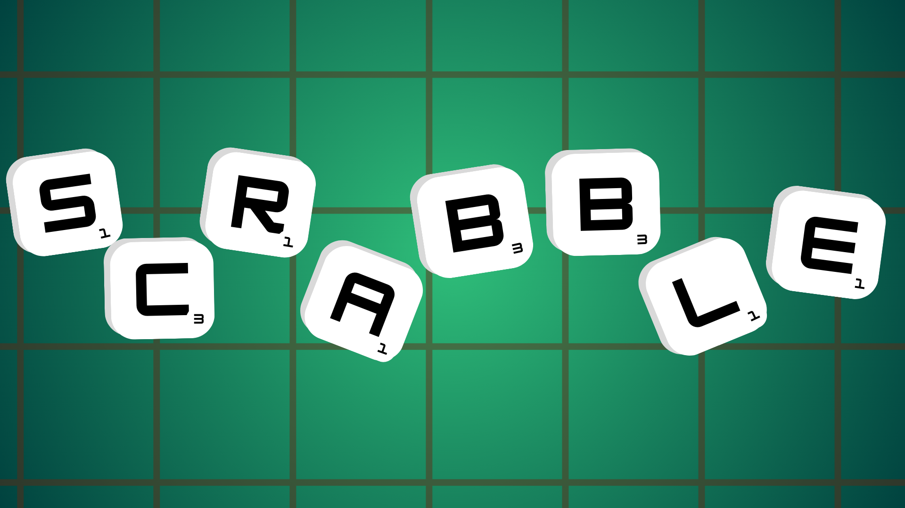

[](https://gitlab.emi.u-bordeaux.fr/pdp-2025/scrabble-1)

# README - Projet de Programmation 2025 : Scrabble Java

**Table of Contents**
1. **[About The Project](#about-the-project)**
2. **[Technologies](#technologies)**
3. **[Clone The Repository](#clone-the-repository)**
4. **[Usage](#usage)**
5. **[Contact](#contact)**

## About The Project
This project is a Java implementation of the famous game Scrabble, using multiples technologies, algorithmes, data structures and design patterns. The game is supposed to be played from 2 to 4 players, either by human or AI. The game can be played in a console or a graphical interface. Multiples options will allow the user to customize the game.

## Technologies
The project is developed in Java, using the following technologies :

[](https://openjdk.org/projects/jdk/17/) [](https://ba-sh.com/fr/fr/) [](https://git-scm.com/) [](https://gitlab.com/) [](https://www.linux.org/) 

[](https://maven.apache.org/) [](https://junit.org/junit5/) [](https://openjfx.io/) [](https://www.jacoco.org/jacoco/) [](https://checkstyle.org/)

## Clone The Repository
To clone the repository, use the following command :
* **Clone with HTML**
```sh
git clone https://gitlab.emi.u-bordeaux.fr/pdp-2025/scrabble-1.git
```

* **Clone with SSH**
```sh
git clone git@gitlab.emi.u-bordeaux.fr:pdp-2025/scrabble-1.git
```

## Usage
To use the project, you can run the script `scrabble` in the scrabble directory. This script will compile the project if the .jar file is not present in the target directory, and then run the game with the options given in the command line.

* **Run the script**
```sh
./scrabble [options]
```
note : The options are used with the following syntax : `-flag value`.


For more information about the options, you can run the script with the `-h` option.
* **Run the script with the help option**
```sh
./scrabble -h
```

## Contact
* **Project Link** : [Scrabble Java](https://gitlab.emi.u-bordeaux.fr/pdp-2025/scrabble-1)


* **Andrieu Ludovic - ludovic.andrieu@etu.u-bordeaux.fr**
* **Cassard Aymeric - aymeric.cassard@etu.u-bordeaux.fr**
* **Cazet Valentin - valentin.cazet@etu.u-bordeaux.fr**
* **Lou-Poueyou Alexandre - alexandre.lou-poueyou@etu.u-bordeaux.fr**
* **Mayol Jean - jean.mayol@etu.u-bordeaux.fr**
* **Petry Mathéo - matheo.petry@etu.u-bordeaux.fr**
